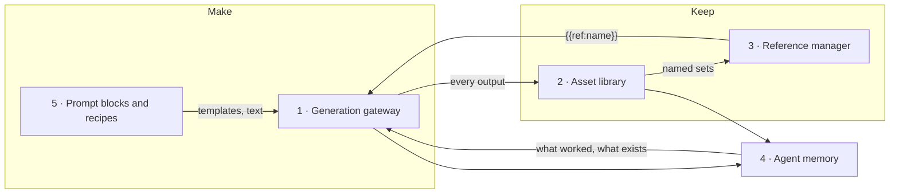
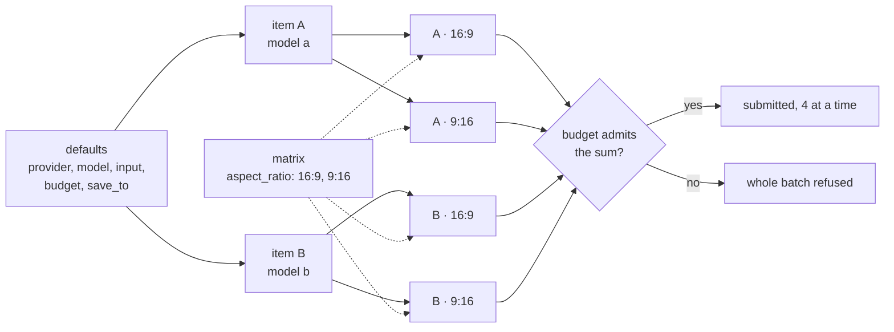
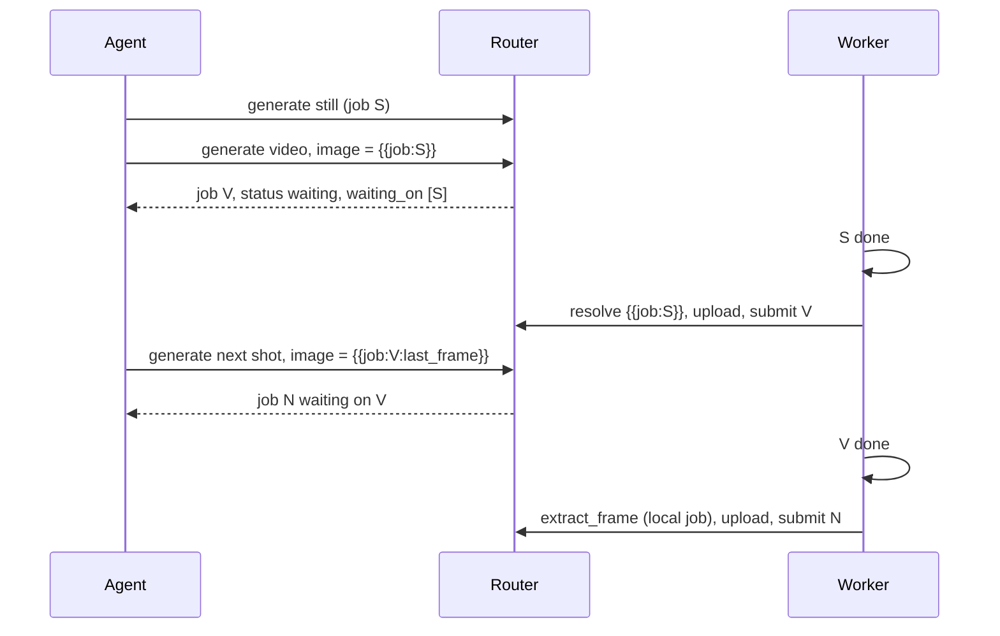
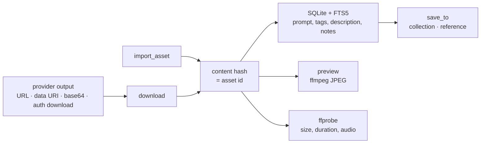
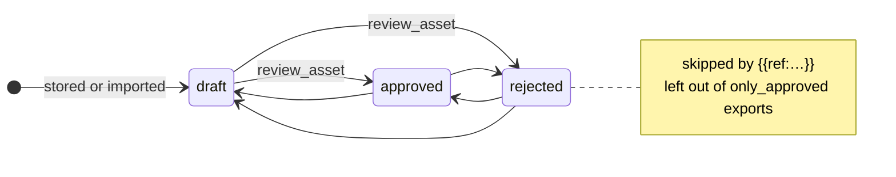
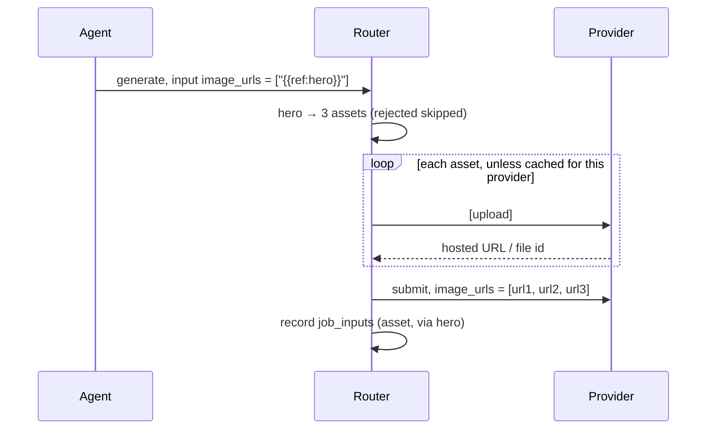
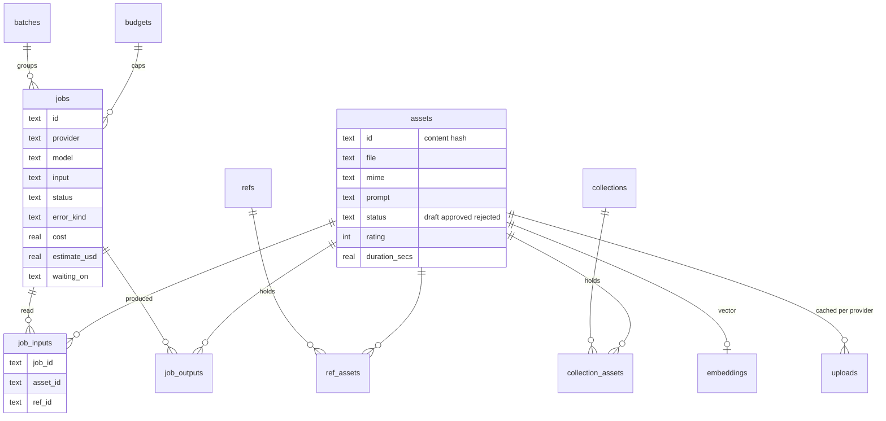
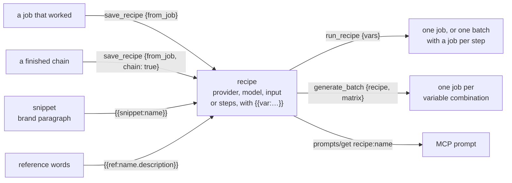

# Concept

AI Media Router is generation and visual-memory infrastructure for AI agents. An agent should be able to:
- generate an image or a video with any provider the user pays for;
- find that result again weeks later;
- reuse it as a reference for the next generation.

All of this should work without the agent knowing where files live or how each provider's API works today.



| Pillar | Answers the agent's question |
|---|---|
| Generation gateway | "Generate this with that model, at that price." |
| Asset library | "Where is everything I have generated?" |
| Reference manager | "Keep this character and this style consistent." |
| Agent memory | "What did I make before, from what, and what worked?" |
| Prompt blocks and recipes | "Do that again, with this changed." |

## Principles

1. **Agent first.** MCP is the primary interface; REST and CLI expose the same
   contract (`src/api/`). Every result says what to do next. Every error names
   the provider, the step, the spec file and the fix.
2. **Bring your own keys, no middleman.** Keys stay on the user's machine, in the OS
   keychain or in `<home>/config.toml` with mode 0600. They are set from a terminal
   (`ai-media-router keys set NAME`) and never pass through the agent conversation:
   no MCP or REST tool accepts a key value. AI Media Router never resells or proxies
   through its own account.
3. **The agent chooses.** Prices from the catalog are shown, but there is no
   hidden "cheapest" routing or silent fallback: the agent (or user) picks the
   provider and the model, so cost and quality are explicit decisions.
4. **Pass-through, not a lowest-common-denominator schema.** `model` and `input`
   go to the provider unchanged. A unified schema would always lag behind new
   model parameters; instead `get_provider` tells the agent what the provider
   expects.
5. **Providers are data.** One TOML file per provider. When an API changes, an
   agent reads the raw exchange, edits the spec, checks it against fixtures and
   saves an override: no rebuild, no restart (see [provider-spec.md](provider-spec.md)).
6. **Local first, nothing expires.** Provider result URLs die after hours or days
   (kie keeps files 14 days, WaveSpeed 7). Every output is downloaded at once into
   `<home>/assets/` and indexed in SQLite, so the library outlives any provider.

## 1. Generation gateway

One job API over 43 provider specs, one of them a self-hosted ComfyUI server
(`comfyui`: the workflow in API format is the input, every job costs 0 USD).

- **Jobs.** `generate` submits and returns a job at once. A worker polls by lease,
  so jobs survive restarts and several MCP processes share one queue. `get_job`
  waits up to 50 s per call, shows provider progress, and with `debug=true` shows
  the raw request and response of every step.
- **Prices.** `search_prices` links catalog offers to a `provider_key` and lists only
  the user's configured providers by default (once any key is set), so the agent
  compares video (per second) and image (per image) prices across the providers it
  can actually call. It is for choosing: a saved preset runs directly with
  `generate {recipe, input}`, and a new choice is offered as a preset with its `offer_id`.
- **Checks before spending.** `preflight` runs every check `generate` would run
  (keys, placeholders, upload support, cost, budget) and renders the exact requests,
  without sending anything. `doctor` checks the installation as a whole.
- **Retries.** `retry {attempts, delay_secs}` resubmits the same job after a
  retryable failure (`rate_limit`, `provider_error`, `network`, `timeout`). It is off
  by default, since a provider may bill a failed attempt.
- **Reuse.** Each job stores a fingerprint of provider, model and expanded input,
  with library files counted by content hash rather than by upload URL. `reuse: true`
  answers a repeat from a finished job whose outputs are still in the library: a new
  job marked `reused_from`, cost 0, linked to the same assets. A new row, not the
  original, keeps history, `save_to`, batches and lineage per request, while stats
  and price history skip reused rows. An identical request made while the first runs
  (started in the last 5 minutes) is merged into it by default, since agents call
  again after client timeouts; `reuse: false` always submits. `preflight` and
  `estimate_cost` show a reuse as cost 0.
- **Spec self-repair.** `get_spec` → `check_spec` → `save_spec` / `reset_spec`.

### Batches

`generate_batch {defaults, items, matrix, label}` starts up to 100 jobs: every
item times every matrix combination.



- **Merging.** Item `input` merges over `defaults.input`, then the matrix values
  set top-level fields. A failed submit becomes a failed job, and the batch goes on.
- **Bench.** A bench is one input over several provider/model items with
  `save_to.collection`, so the results end up side by side.
- **Recipe fan-out.** `generate_batch {recipe, matrix: {language: [...], aspect: [...]}}`
  runs a saved recipe once per combination of its *variables*. This is the
  localization fan-out.
- **Pricing.** `offer_id` in defaults or items prices each job from its own input.
- **Following a batch.** `get_batch` follows it as one unit; `list_jobs {batch}`
  lists its jobs.

### Chains

`"{{job:<id>}}"` / `"{{job:<id>:<n>}}"` in input use another job's outputs:
still → video → repair. `"{{job:<id>:last_frame}}"` hands the last frame of a video
job to the next shot.



- **Parent already finished.** It resolves at once.
- **Parent still running.** The new job is `waiting` until the parent is done. The
  worker then uploads the outputs, submits, and records them as inputs, so lineage
  spans the whole chain.
- **Parent failed.** Its children fail too.
- **Cancelling.** `cancel_job` fails a waiting or running job locally, together with
  its waiting children. The provider is not told.

### Budgets and cost estimates

- **Budgets (opt-in).** `set_budget {name, limit_usd}` creates a USD cap for a
  session or a project. A job is refused when spent + estimate would exceed the
  limit, so an agent given "$5" cannot overspend. A job counts its reported USD
  cost once known, otherwise its estimate. Failed jobs count nothing.
- **Offers.** Every offer has a stable `offer_id` built from provider, model,
  variant, mode, resolution, audio and quality (not the price).
- **Estimates.** `estimate_cost {provider, model, input, offer_id}` multiplies the
  offer's price by the duration or image count found in `input`. It returns the
  formula and the fields it read, plus the median of past jobs on that
  provider+model that reported USD. With a budget and no explicit estimate, the
  computed one is admitted: the offer first, the history median second. The
  refusal says why when neither exists.
- **Catalog.** `jutsuhq/ai-media-api-prices` publishes `prices.json` (video, USD
  per second) and `image-prices.json` (USD per image, by size and quality tier; modes
  `generate`, `edit`, `generate + edit`). Both are cached in `<home>` for a day.
  `search_prices {kind: "image", quality}` lists image offers from configured
  providers. `base` marks the ~1 MP rows to compare, and `notes` holds surcharges
  (extra megapixels, reference images).
  Price tiers of one page get distinct ids, ranked by price.

Deliberately not built: automatic cheapest routing and automatic fallback
(principle 3).

## 2. Asset library

Every output and every imported file becomes an asset.



- **Identity.** Ids are content hashes, so identical files are stored once. Files
  live in `<home>/assets/`. A file made by several jobs keeps every one of them as
  a producer (`job_outputs`).
- **Metadata.**
  - On the asset: MIME type, size, source job, prompt, tags, description, created
    time.
  - With ffprobe installed: `width`, `height`, `duration_secs` and `has_audio`.
  - On the linked job: model, provider, full input and cost.
- **Search.** Full-text search over prompts, tags, descriptions and review notes
  (SQLite FTS5).
- **Collections** (projects).
  - Tools: `add_to_collection`, `remove_from_collection`, `search_assets {collection}`,
    and `save_to.collection` on `generate`.
  - A collection exists while it holds assets.
- **Previews.** With ffmpeg installed, each image gets a scaled JPEG and each video
  its first frame. `get_asset` makes missing previews and metadata.
- **Media operations** (ffmpeg, local, no provider): `extract_frame`, `reframe`,
  `trim`, `concat`, `overlay` (a real packshot over a generated plate) and
  `mux_audio`. Each result is a new asset produced by a finished job with provider
  `local` (model = operation, input = parameters, cost 0), so lineage, history and
  `save_to` work as for generations.
- **Provenance in files.** Saved job outputs carry `generator`, `job_id`, `provider`,
  `model`, `input`, `prompt` and `parents` as JSON: a PNG `iTXt` chunk, a JPEG `COM`
  segment, or the MP4/MOV/WebM `comment` tag (ffmpeg stream copy). Keys are redacted,
  URLs lose query string and credentials (or become `{{asset:<id>}}`), data URIs are
  dropped. `import_asset` reads it back: prompt, tags, the job (recreated in another
  library, so `save_recipe {from_job}` works) and lineage to parents, reporting the
  ones still missing. Other formats are stored unchanged; `EMBED_METADATA = "false"`
  turns writing off. The record makes each job's file unique, so identical provider
  bytes from two jobs become two assets while it is on.
- **Export.** `export_collection` writes `<home>/exports/<name>-<time>.zip`
  containing `files/`, `previews/` and `collection.json`. The manifest holds each
  asset's metadata and review fields, the job that made it (with provider, model,
  input and cost) and its references. `only_approved` ships only approved assets.

### Review gate



- **Fields.** Every asset has a `status`, a `rating` (1–5) and `review_notes`
  (full-text indexed).
- **Setting them.** `review_asset {asset_ids, status, rating, notes}` sets them for
  many assets at once.
- **Filtering.** `search_assets {status, min_rating}` filters by them.
- **Effect on generation.** A rejected take never feeds the next generation.

## 3. Reference manager

A **reference** is the unit of visual consistency: a named, typed set of assets
plus a description. For example, "Main character" = three portraits + "red-haired
woman, cyberpunk jacket".

| Kind | Keeps consistent |
|---|---|
| `character` | a person's or creature's appearance |
| `style` | look, palette, rendering |
| `product` | an object that must stay exact |
| `environment` | a location |
| `composition` | framing, camera |
| `brand` | logos, identity |



- **Tools.**
  - `save_reference` creates a reference or updates its fields; `asset_ids`
    replaces the set.
  - `get_reference`, `list_references {kind, query}`, `add_to_reference {role}`,
    `remove_from_reference`.
  - `delete_reference` deletes the reference; its assets stay in the library.
- **Placeholders.** `"{{asset:<id>}}"` or `"{{ref:<name or id>}}"` must be a whole
  string value inside `input`.
  - As an array element, a ref expands to all its assets in order.
  - As a single value, it becomes its first asset.
- **Text from a reference.** `{{ref:<name>.description}}` and `{{ref:<name>.tags}}`
  put the reference's words inside a prompt. The prompt then describes the
  product exactly as the reference does.
- **Upload cache.** Uploads are cached per (asset, provider) until the spec's
  `[upload].ttl_secs` (default 24 h) minus one hour. `data_uri` providers are not
  cached. Providers without uploads get an error asking for public URLs.

## 4. Agent memory

Agents forget between sessions; the library must not.



- **History.** `list_jobs {reference, collection, batch, status, error_kind}`
  returns jobs with their inputs, provider and cost.
- **Lineage.** Every asset resolved from a placeholder is recorded as an input of
  the job (`job_inputs`), and every file a job made as an output (`job_outputs`).
  Together they form the generation graph: reference → portrait → scene →
  extracted frame → final video. `get_lineage(asset_id)` returns ancestors and
  descendants with depth, the job of each step and the reference an input came
  through.
- **Similarity.** `similar_assets {query | asset_id}` ranks assets by cosine
  similarity of embeddings of their prompt, tags and description. The embeddings
  come from any OpenAI-compatible `/embeddings` endpoint. Vectors are recomputed
  when the text or the model changes.
- **Stats.** `get_stats {provider, model, collection}` shows, per provider and
  model:
  - jobs and the done/failed share;
  - failures per kind;
  - average rating and approved share;
  - average USD cost;
  - seconds to finish.

  It is the agent's memory of what worked.
- **Failure kinds.** A failed job carries `error_kind`, `retryable` and a hint.
  The kind is taken from, in order:
  1. the provider's text: built-in patterns, then the spec's `[errors.kinds]`;
  2. the HTTP status, or a 3-digit `[errors].code`;
  3. the engine's own messages (a pointer that matched nothing is `spec`).

A typical request, handled in one agent turn:

> Find my character from the last project, use her look, make three cyberpunk
> images and keep them with the character.

`search_assets` / `get_reference` → `generate` ×3 with `"{{ref:main-character}}"`
and `save_to {reference, collection}`. The outputs are stored, linked to the
reference and traceable.

## 5. Prompt blocks and recipes

Production work repeats: the same brand paragraph in every prompt, the same
working generation rerun with a new line of text, the same tool sequence for a
product shoot. These are stored once and reused.



- **Text placeholders** go anywhere inside an input string:
  - `{{snippet:<name>}}`, `{{ref:<name>.description}}`, `{{ref:<name>.tags}}`.
  - They are replaced at submit; the job stores the input with placeholders.
  - Unknown names fail with the list of known ones.
  - Snippets cannot include other snippets, but can include reference text.
- **Snippets.** `save_snippet {name, text}`, `list_snippets`, `delete_snippet`.
- **Recipes** are saved generation templates.
  - A single-generation recipe is a **preset**: `save_recipe {name, provider, model, input,
    save_to, offer_id, budget, description}`, then `generate {recipe, input}`, whose `input`
    merges over the preset's field by field. `list_recipes` shows them.
  - Create one with `save_recipe {name, from_job}`, or with
    `{name, provider, model, input, save_to, variables: {name: {description, default}}}`.
  - `{{var:<name>}}` in the input is filled by `run_recipe {name, vars}` or by
    `generate_batch {recipe, matrix}`. As a whole string it takes the value's JSON
    type.
  - Variables that are used but not declared become required. A missing variable
    fails with the recipe's variable list.
- **Chain recipes** hold `steps` instead of one generation, like a ComfyUI
  subgraph saved as a blueprint.
  - A step is a generation `{name, provider, model, input}` or an ffmpeg edit
    `{name, op, input}` whose input is that tool's parameters.
  - `{{step:<name>}}`, `{{step:<name>:<n>}}` and `{{step:<name>:last_frame}}`
    take an earlier step's outputs. Only earlier steps can be named, so a recipe
    has no cycles; the whole string must be the reference.
  - `run_recipe` creates every step's job at once in one batch. Each `{{step:…}}`
    becomes the `{{job:…}}` of that step's job, so a step waits through the same
    `waiting_on` mechanism as any chained job. Edit steps are `local` jobs that
    wait the same way; the worker runs them with ffmpeg once their parents are
    done and they finish as ordinary local jobs, with lineage and `save_to`.
  - The run returns the last step's job; `get_batch` shows every step (`jobs[].step`)
    and, as `outputs`, the files of the final steps, those no other step uses.
  - A failed step fails the steps after it: ``step `<name>` (job …) failed: …``.
  - Money is planned per step (`estimated_cost_usd` or `offer_id` on each
    generation step, edits cost 0). A budget admits the sum before anything is
    submitted. `preflight {recipe, vars}` checks every step and the sum;
    `estimate_cost {recipe, vars}` prices each step.
  - `save_recipe {from_job, chain: true}` builds the steps from lineage: the jobs
    behind `{{job:…}}`, behind `{{asset:…}}` made by a job, and behind the asset ids
    of an edit, down to imported files and references, which stay as they are.
- **MCP prompts** are built-in workflows that name the exact tools in order:
  - `product_shoot`: product locked by a reference.
  - `ugc_ad`: persona still → talking video.
  - `character_consistency`.
  - `localization_fanout`: one approved job → recipe → one run per language.
  - `fix_provider`: debug trace → spec edit → check → save.

  Every recipe is also a prompt `recipe:<name>` whose arguments are its variables;
  its text lists the steps and variables and the tools to run and follow it.

## Storage

```
<home>/
  ai-media-router.db   jobs (incl. local media operations), assets, references, collections,
                       lineage, batches, budgets, embeddings, snippets, recipes, upload cache
  assets/              downloaded and imported files, named by content hash; generated
                       files carry their provenance (provider, model, input, job, parents)
  assets/previews/     JPEG previews
  exports/             collection ZIPs
  providers/           local spec overrides (hot-reloaded)
  config.toml          [env]: settings; secrets in the file (mode 0600) or keychain markers
  prices.json          cached video price catalog
  image-prices.json    cached image price catalog
```

One SQLite file and a folder: easy to back up, sync or inspect. The schema is
`src/db/schema.sql`; the project is pre-release, so it changes in place without
migrations.

## Roadmap

1. Live verification of every provider spec against real responses.
2. Visual similarity through a multimodal embedding endpoint, and sqlite-vec once
   libraries outgrow a brute-force scan.
3. S3-compatible storage behind the same asset API.
4. Specs for image providers the catalog lists but the router does not serve yet:
   OpenAI, Black Forest Labs, Recraft, Stability AI, Ideogram.
