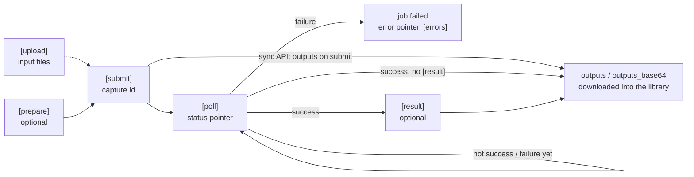

# Provider spec format

Every provider is one TOML file in `providers/<key>.toml`. The generic engine
(`src/providers/engine.rs`) runs it; adding a provider never needs Rust code.
Files in `<AI_MEDIA_ROUTER_HOME>/providers/*.toml` are loaded at runtime too and
override built-in ones with the same `key`; they are re-read within a second of
changing, without a restart.

A generation is a chain of HTTP steps; every box is a section of the TOML:



Every request goes through `[auth]` and `[headers]`; every response through
`[errors]` (2xx bodies that carry an error code) before its pointers are read.

## Fixing or adding a provider

The loop is the same for an agent over MCP and for a human with the CLI; nothing
needs a rebuild or restart.

| Step | MCP tool | CLI |
|---|---|---|
| 1. See what the provider really returned | `get_job {job_id, debug: true}` | `ai-media-router jobs <id> --debug` |
| 2. Read the active spec | `get_spec {provider}` | `ai-media-router spec show <key>` |
| 3. Edit the TOML, then check it | `check_spec {spec, model, input}` | `ai-media-router spec check <key> --file x.toml --model … --input '{…}'` |
| 4. Activate it | `save_spec {spec}` | `ai-media-router spec save x.toml` |
| 5. Run a real generation | `generate` | `ai-media-router generate … --wait` |
| Undo | `reset_spec {provider}` | `ai-media-router spec reset <key>` |

1. **Errors say where to look.** Every step error starts with
   `<key> <step> (<builtin providers/<key>.toml | override <path>>)` and names the
   failing field: `capture id pointer /data/taskId matched nothing in the response: {…}`,
   `provider error code 1008 at [errors].code /base_resp/status_code: …`,
   `finished, but outputs pointers ["/output"] matched no media …`. A job that stays
   `running` reports the provider's status in `progress`
   (`provider status queued`, or `status pointer /x matched nothing`), and a failed
   poll shows up there too; after 20 failed polls in a row the job fails.
2. **The trace is the raw truth.** `debug: true` adds `trace`: the last request
   (credentials shown as `<ENV_NAME>`) and response (status, headers, body) of
   every step. Long strings such as inline base64 are shortened.
3. **`check_spec` is offline.** It validates the TOML (line/column errors,
   pointers must start with `/` or `header:`, every `{{var}}` must be provided or
   captured somewhere), replays the provider's fixtures, and with `model`/`input`
   renders the exact requests a generation would send. Variables later steps
   capture appear as `<id from submit /data/taskId>`; pass `vars` to fill them.
4. **`save_spec`** writes `<home>/providers/<key>.toml` (or the override file
   already in use) and reloads every AI Media Router process using that home. It
   refuses `command` auth that differs from the built-in spec, and is disabled for
   `serve` on a non-loopback address unless `--allow-spec-writes` is given.
5. **Make the fix stick.** Copy the override into the repo's `providers/<key>.toml`
   and add or update a fixture (below) so `cargo test` keeps it working. A job's
   `trace` has the same shape as a fixture's `exchanges`.

## Top level

| Field | Required | Meaning |
|---|---|---|
| `key` | yes | Lowercase id, `[a-z0-9-]+`. Agents pass it as `provider`. |
| `name` | yes | Human name. |
| `catalog` | yes | Provider names exactly as they appear in the price catalog (`provider` field of `prices.json` and `image-prices.json`). May be empty. |
| `docs` | yes | URL where an agent finds model ids and input fields. |
| `model_hint` | yes | One or two sentences for agents: what `model` means for this provider and what goes into `input`. |
| `base_url` | yes | Prefix for relative step URLs. A template, so `https://{{env.WORKSPACE}}.example.com/api` or a self-hosted server's `{{env.COMFYUI_URL}}` works. Every `env` variable in it must be set for the provider to count as configured. |
| `download_auth` | no | `true` if result files must be downloaded with the auth headers. Default `false`. |
| `notes` | no | Quirks and unverified parts; shown to agents by `get_provider`. |
| `cost_unit` | no | Unit of job `cost`, e.g. `"USD"`, `"credits"`, `"tokens"`; shown on jobs and by `get_provider`. |
| `cost_multiplier` | no | Factor applied to every reported cost, e.g. `1e-10` for xAI's USD ticks, `0.000001` for micro-USD. |
| `fixed_cost` | no | Cost of every job (in `cost_unit`) when no step reports one, e.g. `0` for a self-hosted server. With `cost_unit = "USD"` it is also the estimate, so budgets admit jobs without `estimated_cost_usd`. |
| `[example]` | no | `model` + `input` of a known-good call, shown by `get_provider`. Without it, the first fixture's model and input are shown. |
| `[auth_check]` | no | A GET `url` that only checks the credentials and spends nothing (account, balance, key info or model list), called by `test_key`. No body, form, multipart, `capture` or `outputs`; `method`, when given, is GET. |

## Templates

Strings anywhere in `base_url`, `url`, `body`, `headers`, upload `fields` are templates:

- `{{model}}` – the model id the agent passed (inserted raw, slashes kept).
- `{{id}}` and any other captured variable (see `capture`).
- `{{uuid}}` – a fresh UUID v4, the same value for the whole job (idempotency keys).
- `{{request_uuid}}` – a new UUID v4 on every use (per-request trace ids).
- `{{env.NAME}}` – environment variable / config value `NAME`.
- A string that is **exactly** one variable, e.g. `"{{input}}"` or `"{{operation}}"`, is replaced by that variable's JSON value (object, number…), not by its text.
- An object key `"$merge" = "{{input}}"` merges the input object's fields into that object, after the other keys: input fields override template defaults.

## Pointers

Used by `capture`, `status`, `error`, `cost`, `outputs`, `[errors]` and upload `result`.
RFC 6901 JSON pointers into the response body (`/data/taskId`, `/output/0`) plus:

- `*` segment maps over an array (or object values): `/data/*/videoURL`.
- `*[key=value]` keeps only array items whose `key` equals `value`: `/steps/*[type=model_output]/content/*`.
- `A#B`: resolve `A`; if it is a string containing JSON, parse it and resolve `B` inside:
  `/data/resultJson#/resultUrls`.
- `header:Name` reads a response header (case-insensitive): `cost = "header:X-Comfy-Credits-Used"`.

A pointer of `""` means the whole body.

## `[auth]`

| `type` | Fields | Sends |
|---|---|---|
| `bearer` | `env = ["KEY"]` | `Authorization: Bearer <KEY>` |
| `header` | `env = ["KEY"]`, `name`, optional `prefix` | `<name>: <prefix><KEY>` |
| `query` | `env = ["KEY"]`, `param` | `?<param>=<KEY>` on every request |
| `headers` | `env = ["A", "B"]`, `names = ["X-Key", "X-Secret"]`, optional `prefixes` | one header per env var |
| `basic` | `env = ["USER", "PASS"]` | HTTP basic auth |
| `jwt_hs256` | `env = ["ACCESS", "SECRET"]`, optional `ttl_secs` (default 1800) | `Authorization: Bearer <JWT{iss: ACCESS, exp, nbf}>` signed with SECRET |
| `command` | `command = ["gcloud", "auth", "print-access-token"]`, optional `env` (token override) | `Authorization: Bearer <stdout>`, cached 30 min |
| `none` | optional `env` | nothing; use with `[headers]` templates like `Authorization = "Key {{env.ID}}:{{env.SECRET}}"`. Listed `env` vars still gate "configured" |

`optional = true` (any type) sends the credentials only when every `env` variable is
set and never counts them as missing, e.g. a token for a self-hosted server that
may or may not sit behind an authenticating proxy.

A provider counts as configured when every `env` variable of `[auth]` is set
(for `command`: the command exists or the env override is set), or when every
variable of some route's `auth` is set.

## `[headers]`

Extra headers on every request of every step and upload, templated. Example:
`"X-DashScope-Async" = "enable"`. A step can add its own `headers` table
(e.g. `Idempotency-Key` on submit only).

## `[errors]` (optional)

For APIs that return errors inside a 2xx body.

```toml
[errors]
code = "/code"     # pointer
ok = [200]         # values that mean success (numbers or strings)
message = "/msg"   # pointer, or a list of pointers
```

Applied to every step response in which `code` exists. Non-2xx HTTP is always an error;
when its body is JSON, `message` explains it too (`HTTP 400: <message>`), so `message`
works without `code`. A list of pointers joins every non-blank value found with `; `,
e.g. ComfyUI's `["/error/message", "/error/details", "/node_errors/*/class_type"]`.

### `[errors.hints]` (optional)

What to do about an error, keyed by a text pattern (case-insensitive substring). The
first matching hint is appended as `— fix: <hint>` to step errors and poll failures:

```toml
[errors.hints]
"custom node may not be installed" = "install the custom node pack (ComfyUI-Manager) and restart ComfyUI"
```

### `[errors.kinds]` (optional)

A failed job gets an `error_kind` (see the README). The built-in patterns cover
common wording ("content policy", "insufficient", "rate limit", ...); a provider
with its own wording adds text patterns per kind, matched case-insensitively as
substrings of the error, before the built-in ones and before the HTTP status:

```toml
[errors.kinds]
moderation = ["sensitive word", "audit failed"]
quota = ["credits exhausted"]
```

Kinds: `moderation`, `auth`, `quota`, `rate_limit`, `invalid_input`, `not_found`,
`provider_error`, `network`, `timeout`, `spec`, `cancelled`. Unknown kinds and
empty lists are rejected. `[errors.kinds]` alone (no `code`) is valid; `ok` needs `code`. A 3-digit `code` value (e.g. kie's `402`) is classified
like an HTTP status.

## Steps: `[prepare]`, `[submit]`, `[poll]`, `[result]`

Common fields:

| Field | Meaning |
|---|---|
| `method` | `GET`, `POST`, `PUT`… Default: `POST` for submit, `GET` otherwise. |
| `url` | Template. Relative to `base_url` unless it starts with `http`. Captured full URLs work: `url = "{{status_url}}"`. |
| `headers` | Table of extra headers for this step only, templated. |
| `body` | Templated JSON value (TOML table/array). Omitted = no body. |
| `form` | `true` sends the rendered body object as `application/x-www-form-urlencoded`. |
| `multipart` | `true` sends the rendered body object as `multipart/form-data` text fields; an array value repeats the field. |
| `capture` | Table `var = "pointer"`; captured values become template variables for later steps. |
| `outputs` | Array of pointers to result media (see below). |
| `cost` | Pointer to the cost reported by the provider (any unit). Read from submit, poll and result; the latest step that has it wins. |

`[prepare]` (optional, default `POST`) runs once before submit with the same
`input`; its captures are available to submit, e.g. a price quote that the
create call requires (`quote_id = "{{quote_id}}"`).

`[submit]` must capture `id`, unless the API is synchronous: then give
`[submit].outputs` and omit `[poll]`. If both exist and submit already returned
outputs, polling is skipped.

`[poll]` adds:

| Field | Meaning |
|---|---|
| `status` | Pointer to the status value. If omitted: success = outputs found, failure = `error` found. A status pointer that matches nothing keeps the job running (with a hint in `progress`); an empty body (`{}`, `[]`, blank) is reported as still running, as ComfyUI's `/history/{id}` is until the prompt finishes. |
| `success` | Status values meaning done. Case-insensitive. |
| `failure` | Status values meaning failed. Everything else = still running. |
| `error` | Pointer (or list of pointers, joined with `; `) to the failure message. With `failure` values listed it only explains a failure; with `failure = []` (fal, Comfy: failed tasks end as COMPLETED) a non-empty `error` on a success status fails the job. |
| `outputs` | Pointers to media, read when status is success (unless `[result]` exists). |

`[result]` (optional) runs once after poll success, for APIs that need a
separate call to fetch the output (fal `response_url`, MiniMax file retrieve,
OpenAI-style `/videos/{id}/content`). Same fields as a step; it may also set
`binary = true` when the response body itself is the media file.

## Outputs

Each pointer may resolve to a string, an array, or objects. Strings are taken as:
`http(s)://…` → downloaded; `data:…;base64,…` → decoded; `/relative/path` →
joined to `base_url` and downloaded with credentials; anything else → ignored.
Objects contribute their `url`, `uri`, `video_url`, `image_url`, `audio_url`,
`downloadUrl` or `download_url` field. An object without one is turned into a URL
by the step's `output_url` template, rendered with the object's own fields
(percent-encoded) as variables; a relative result joins `base_url` and is downloaded
with credentials. ComfyUI returns `{filename, subfolder, type}`:

```toml
outputs = ["/*/outputs/*/images/*[type=output]"]
output_url = "/view?filename={{filename}}&subfolder={{subfolder}}&type={{type}}"
```
Raw base64 goes into `outputs_base64 = ["/pointer"]`: the pointer may resolve to a
string (typed by `output_mime`) or to an object such as `{data, mime_type}`,
`{bytesBase64Encoded, mimeType}` or `{b64_json}`, whose MIME field wins over
`output_mime`.

## `[upload]` (optional)

How a local library file becomes something the provider accepts as a reference.

| `type` | Fields |
|---|---|
| `multipart` | `url`, optional `method` (default POST), `file_field` (default `file`), `fields` (templated, `{{file_name}}` available), `result` pointer to the hosted URL or id |
| `json` | `url`, `body` (templated; `{{base64}}`, `{{data_uri}}`, `{{file_name}}`, `{{mime}}`, `{{size_bytes}}` available), `result` pointer |
| `data_uri` | nothing – the provider accepts `data:` URIs directly in input |
| `put` | presigned PUT: `url` + `body` request returns `capture` (`upload_url`, `file_url`), then the bytes are `PUT` to `{{upload_url}}` without credentials; returns `file_url`. `put_headers` = pointer to an object of headers the presign response requires on the PUT |
| `post_form` | presigned POST form (S3 style): like `put`, but the file is POSTed as multipart to `upload_url` together with the fields at the `form_fields` pointer; `file_field` defaults to `file` |

`complete` (`put` / `post_form`, optional) is a step run after the file transfer
(e.g. `POST /v1/files/{{file_id}}/complete`); its templates see the upload
variables and captures. With `complete`, `result` is a pointer into its response
and `file_url` need not be captured.

`usage` (any type) tells agents where the returned reference goes when it is not
a plain URL, e.g. Luma's `{"file_id": …}`; `upload_asset` returns it.

`ttl_secs` (any type but `data_uri`) is how long the returned URL or id stays
usable. `{{asset:…}}` / `{{ref:…}}` placeholders and `upload_asset` reuse an
upload until one hour before it expires; without `ttl_secs` they assume 24 hours,
so set it for providers that delete uploads sooner.
Without `[upload]` the agent must supply public URLs itself.

## `[[route]]` (optional)

When one provider uses different endpoints per model family:

```toml
[[route]]
models = ["kling/*", "minimax/*"]   # glob on the model id; first match wins
[route.auth]                        # optional: other credentials for these models
type = "jwt_hs256"
env = ["KLING_ACCESS_KEY", "KLING_SECRET_KEY"]
[route.submit]
url = "/proxy/{{model}}"
[route.poll]
url = "/proxy/{{model}}/{{id}}"
```

A route's steps (`prepare`, `submit`, `poll`, `result`) replace the top-level
steps of the same name; unspecified steps fall back to top-level.

Glob lists of model families go stale when providers add models. Give such a
route an explicit prefix the agent controls:

```toml
[[route]]
strip_prefix = "image:"
models = ["image:*", "gpt-image-*", "*-text-to-image"]
```

`image:brand-new-model` then takes this route and is sent as `brand-new-model`. Uploads and downloads always use the top-level auth.

A route without steps uses the top-level ones, so the opposite escape is one
route listed first, before any glob that could catch the id:

```toml
[[route]]
strip_prefix = "video:"
models = ["video:*"]
```

## Fixtures

`providers/fixtures/<key>/<case>.json` records what a provider sends back, and
the test `builtin_fixtures_replay` runs each one through the real engine with
the built-in spec (no network). `check_spec` replays them against a candidate
spec, together with `<home>/providers/fixtures/<key>/*.json`.

```json
{
  "source": "where the responses come from (docs example, real job trace)",
  "model": "kling-2.6/image-to-video",
  "input": { "prompt": "a cat" },
  "env": { "GOOGLE_CLOUD_LOCATION": "us-central1" },
  "exchanges": [
    { "step": "submit",
      "request": { "method": "POST", "url": "https://api.kie.ai/api/v1/jobs/createTask",
                   "headers": { "authorization": "Bearer <KIE_API_KEY>" },
                   "body": { "model": "kling-2.6/image-to-video", "input": { "prompt": "a cat" } } },
      "response": { "status": 200, "headers": {}, "body": { "code": 200, "data": { "taskId": "t1" } } } },
    { "step": "poll", "request": { "method": "GET", "url": "…" }, "response": { "status": 200, "body": { … } } }
  ],
  "expect": { "outputs": ["https://cdn/x.mp4"], "cost": 55 }
}
```

- Exchanges are consumed in order; each request must match the recorded `method`
  and `url`, the listed `headers`, and `body` if present (the first difference is
  reported as a pointer). Credentials appear as `<ENV_NAME>`, `{{uuid}}` and
  `{{request_uuid}}` as `00000000-0000-4000-8000-000000000000`.
- `expect.outputs` lists URLs, or `inline:<mime>:<bytes>` for decoded media;
  `expect.cost` is compared after `cost_multiplier`;
  `expect.error` instead requires a failure containing that text.
- `upload: {file_name, mime}` replays an upload of the 7-byte file `fixture`
  (steps `upload`, then `upload_put` / `upload_post`, then `upload_complete`);
  `expect.reference` is the result.
- Every recorded exchange must be used.

## Example

```toml
key = "kie"
name = "kie.ai"
catalog = ["kie.ai"]
docs = "https://docs.kie.ai/market"
model_hint = "Model id from the kie market docs, e.g. `kling-2.6/image-to-video`. `input` is that model's input object."
base_url = "https://api.kie.ai"

[auth]
type = "bearer"
env = ["KIE_API_KEY"]

[errors]
code = "/code"
ok = [200]
message = "/msg"

[submit]
url = "/api/v1/jobs/createTask"
body = { model = "{{model}}", input = "{{input}}" }
capture = { id = "/data/taskId" }

[poll]
url = "/api/v1/jobs/recordInfo?taskId={{id}}"
status = "/data/state"
success = ["success"]
failure = ["fail"]
error = "/data/failMsg"
cost = "/data/creditsConsumed"
outputs = ["/data/resultJson#/resultUrls"]

[upload]
type = "multipart"
url = "https://kieai.redpandaai.co/api/file-stream-upload"
fields = { uploadPath = "ai-media-router", fileName = "{{file_name}}" }
result = "/data/downloadUrl"
```
